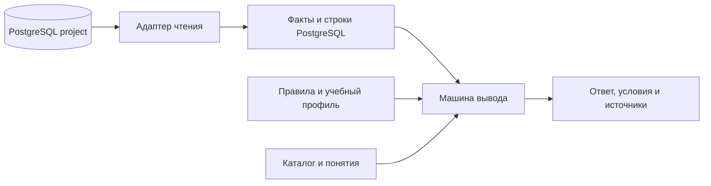

# Выбор модели представления знаний

Обе пробные модели используют десять ID каталога из `trial/scenarios.json`. Из них семь описывают схему проекта и три задают учебную политику и обработку пропуска. Сценарии представляют синтетические факты об одном узле. Проверяются шесть результатов: путь узла, состав, отсутствие показания GPU5 и три исхода диагностики GPU0 на 61 °C, ровно на 80 °C и при пропуске.

| Требование | Логическая модель | Продукционная модель |
|---|---|---|
| Объяснимость | Предикат возвращает статус и ID основания. Проверенные подцели пришлось бы собирать отдельно. | Условия уже представлены данными. Итоговый движок возвращает результаты проверок и совпавшие правила с меньшим приоритетом. |
| Изменение правил | Для изменения логики диагностики редактируются предикаты и проверяется их совместимость. | Условия и сообщения меняются в правилах. Значение учебного предела вынесено в отдельную политику. |
| Исключения | Отсутствие показания выражено через отрицание доказуемости для зарегистрированного источника и фиксированного снимка. | Пропуск представлен явным признаком. Его правило выше проверки порога. |
| Интеграция с PostgreSQL | Пробная версия читает JSON. Для БД потребовался бы адаптер. | Пробная версия читает тот же JSON. Итоговый CLI подтвердил работу через отдельный PostgreSQL-адаптер. |
| Расширяемость | Рекурсивный предикат выражает путь групп без промежуточного представления. | Новые условия диагностики удобно добавлять в таблицу правил. Для отношений нужен явный этап подготовки фактов. |

Проверка `python3 knowledge/trial/check.py` подтвердила одинаковые шесть результатов Python и SWI-Prolog 10.0.2. Оба вывода совпали с `trial/expected.json`, включая ID оснований.

Для v1 выбрана продукционная модель. Порог и пропуск выражаются обеими моделями, а продукционная реализация позволяет хранить порядок разрешения конфликтов отдельно от SQL, объяснить выбор правила и подключить PostgreSQL, не меняя устройство правил. У логической модели короче представление рекурсивной топологии.

